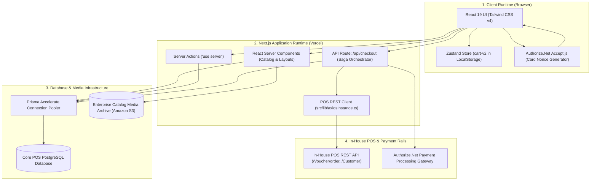

# Enterprise Omnichannel Retail E-Commerce Platform — Engineering Case Study

A documentation-first architectural case study of an enterprise full-stack retail and B2B wholesale commerce platform bridging modern web storefront interactions with brick-and-mortar back-office ERP systems via direct in-house POS REST APIs and direct POS PostgreSQL persistence.

---

## Executive Overview

The **Enterprise Omnichannel Retail Platform** provides a hybrid digital commerce solution supporting direct-to-consumer retail shopping and B2B wholesale customer workflows. The architecture pairs Next.js 16 App Router and React 19 Server Components with a **Dual-Tier Direct In-House POS Integration** pattern, eliminating unnecessary middle-tier queues or serverless ETL functions.

### Architectural Highlights
1. **Next.js 16 App Router & React 19**: Server Components render product catalog pages with zero client bundle overhead; Server Actions orchestrate atomic cart mutations and checkout flows.
2. **Prisma ORM 6.13 with Accelerate**: Overcomes serverless PostgreSQL connection exhaustion through global edge connection pooling and edge-level SWR caching against the Core POS database.
3. **Dual-Tier Direct POS Integration**: Eliminates asynchronous ETL queues and serverless middle-tiers. Read workloads execute directly against the POS database via Prisma; transactional mutations (order voucher creation, payment ledger settlement, cancellations) execute synchronously via the in-house POS REST API.
4. **Two-Phase Distributed Payment Saga**: Card tokens generated via Authorize.Net Accept.js undergo authorization holds (`AUTH_ONLY`), downstream POS voucher generation, prior auth capture, and POS ledger posting, protected by automated compensating voids (`voidTransactionRequest`) and cancellations on failure.

---

## Cloud Architecture Topology

---

## Documentation Index

| Topic | Guide |
|---|---|
| Next.js App Router lifecycle & runtime boundaries | [Architecture](docs/architecture.md) |
| Domain boundaries & bounded context specifications | [Domain Map](docs/domain-map.md) |
| Production TypeScript, Prisma & POS integration implementations | [Code Examples](docs/code-examples.md) |
| Two-phase payment saga & compensating void recovery | [Payment Saga](docs/payment-saga-and-fault-tolerance.md) |
| Prisma ORM 6.13, Accelerate pooling & schema design | [Prisma Database](docs/prisma-database-architecture.md) |
| Dual-tier in-house POS REST API & direct database integration | [Direct POS Integration](docs/pos-api-and-direct-database-integration.md) |
| Architecture Decision Records | [ADRs](docs/decisions/README.md) |
| Reusable Mermaid source files | [Diagrams](diagrams/README.md) |

---

## Technology Map

| Layer | Technologies / Services |
|---|---|
| **Web Framework** | Next.js 16 (App Router), React 19 (Server Components), Tailwind CSS v4 |
| **State & Forms** | Zustand (persisted `cart-v2`), React Hook Form, Zod |
| **ORM & Database** | Prisma ORM 6.13, `@prisma/extension-accelerate`, Core POS PostgreSQL Database |
| **Direct POS Integration** | Direct in-house POS REST API (`/Voucher/order`, `/payment`, `/Customer`), Axios |
| **Object Storage** | Enterprise Catalog Media Archive (Amazon S3 / CDN) |
| **Payment Gateway** | Authorize.Net Accept.js, 2-phase authorization saga with compensating voids |
| **Back-Office ERP** | In-House Physical Store POS ERP System |

---

## Contact

**M Nawaz Khan  Full Stack Developer**
- GitHub: [Nawaz393](https://github.com/Nawaz393)
- LinkedIn: [Muhammad Nawaz Khan](https://www.linkedin.com/in/nawaz393)

[Documentation Index](docs/README.md)
