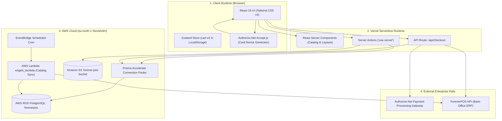

# Engel E-Commerce Platform — Engineering Case Study

A documentation-first architectural case study of **Engel E-Commerce** (`engel-web-app`), an enterprise full-stack retail and B2B wholesale platform bridging web storefront interactions with brick-and-mortar back-office ERP systems (ForeverPOS / SAK Retail Solutions).

---

## Executive Overview

**Engel E-Commerce** provides a hybrid digital commerce solution supporting both direct-to-consumer retail shopping and B2B wholesale quotation management. The platform unites high-performance React Server Components with resilient serverless cloud infrastructure in AWS Region `eu-north-1` (Stockholm).

### Architectural Highlights
1. **Next.js 16 App Router & React 19**: Server Components render product catalog pages with zero client bundle overhead; Server Actions handle cart mutations and checkout orchestration.
2. **Prisma ORM 6.13 with Accelerate**: Overcomes serverless PostgreSQL connection exhaustion through global edge connection pooling and edge-level SWR caching.
3. **Two-Phase Payment Saga with Compensating Voids**: Card tokens generated via Authorize.Net Accept.js are authorized (`AUTH_ONLY`), and if downstream ERP synchronization fails, an automated compensating void (`voidTransactionRequest`) executes to guarantee zero phantom charges.
4. **Serverless Catalog & Inventory ETL (`engels_lambda`)**: An AWS Lambda event microservice continuously ingests vendor catalog files, normalizes tax categories, and performs atomic delta stock syncs using PostgreSQL advisory locks.

---

## Cloud Architecture Topology

---

## Documentation Index

| Topic | Guide |
|---|---|
| Next.js App Router lifecycle & runtime boundaries | [Architecture](docs/architecture.md) |
| Domain boundaries & bounded context specifications | [Domain Map](docs/domain-map.md) |
| Production TypeScript, Prisma & Lambda implementations | [Code Examples](docs/code-examples.md) |
| Two-phase payment saga & compensating void recovery | [Payment Saga](docs/payment-saga-and-fault-tolerance.md) |
| Prisma ORM 6.13, Accelerate pooling & schema design | [Prisma Database](docs/prisma-database-architecture.md) |
| AWS Lambda microservices & serverless ETL pipeline | [Serverless & Lambdas](docs/serverless-infrastructure-and-lambdas.md) |
| Architecture Decision Records | [ADRs](docs/decisions/README.md) |
| Reusable Mermaid source files | [Diagrams](diagrams/README.md) |

---

## Technology Map

| Layer | Technologies / Services |
|---|---|
| **Web Framework** | Next.js 16 (App Router), React 19 (Server Components), Tailwind CSS v4 |
| **State & Forms** | Zustand (persisted `cart-v2`), React Hook Form, Zod |
| **ORM & Database** | Prisma ORM 6.13, `@prisma/extension-accelerate`, AWS RDS PostgreSQL |
| **Serverless Compute** | AWS Lambda (Python 3.11, containerized `engels_lambda`), EventBridge |
| **Object Storage** | Amazon S3 (`forever-pos-bucket`), AWS CloudFront |
| **Payment Gateway** | Authorize.Net Accept.js, 2-phase authorization saga |
| **Back-Office Integration**| ForeverPOS API / SAK Retail Solutions REST bridge |

---

## Contact

**M Nawaz Khan — Full Stack Developer & Cloud Systems Engineer**
- GitHub: [Nawaz393](https://github.com/Nawaz393)
- LinkedIn: [Muhammad Nawaz Khan](https://www.linkedin.com/in/nawaz393)

[Documentation Index](docs/README.md)
