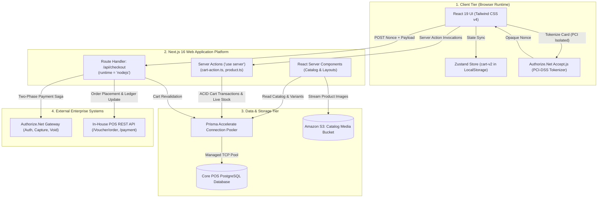

# System Architecture & Technical Design

[← Main README](../README.md) · [← Documentation Index](README.md)

This document details the architectural topology, request lifecycle, runtime boundaries, and cloud infrastructure of the **Enterprise Omnichannel E-Commerce Platform**.

---

## 1. High-Level System Context

The platform bridges digital customer interactions with physical brick-and-mortar retail operations. The architecture is organized across four distinct tiers:

1. **Client Tier (Browser)**: Next.js React 19 UI with Tailwind CSS v4, Zustand persisted cart state, and Authorize.Net Accept.js client-side card tokenization.
2. **Application & Compute Tier**: Next.js 16 App Router hosting React Server Components (RSC), asynchronous Server Actions, and Node.js route handlers.
3. **Data & Storage Tier**: Core POS PostgreSQL database accessed via Prisma ORM 6.13 with Prisma Accelerate connection pooling, paired with Amazon S3 for high-resolution catalog media.
4. **External Services Tier**: Authorize.Net payment processing gateway and direct In-House POS REST API.



---

## 2. Request & Execution Lifecycle

Requests fall into three architectural categories depending on their requirements for streaming, state mutation, or distributed external orchestration:

```mermaid
sequenceDiagram
    autonumber
    actor User as Shopper / Browser
    participant RSC as React Server Component
    participant SA as Server Action ('use server')
    participant API as Route Handler (/api/checkout)
    participant Accel as Prisma Accelerate
    participant RDS as Core POS PostgreSQL
    participant AuthNet as Authorize.Net
    participant POS as In-House POS API

    rect rgb(240, 245, 255)
    Note over User,RDS: Flow A: Server-Rendered Catalog Page (RSC)
    User->>RSC: GET /category/products
    RSC->>Accel: prisma.products.findMany({ where: { companyid } })
    Accel->>RDS: Pooled SQL Query (or Edge Cache Hit)
    RDS-->>Accel: Product Records & Variants
    Accel-->>RSC: Hydrated Models
    RSC-->>User: Stream HTML + RSC Payload (Zero Client JS for markup)
    end

    rect rgb(245, 255, 245)
    Note over User,RDS: Flow B: Atomic Cart Mutation (Server Action)
    User->>SA: attachActiveCartToUser({ userId, companyId })
    SA->>Accel: prisma.$transaction(async (tx) => { ... })
    Accel->>RDS: BEGIN; Merge anon cart; clamp stock; COMMIT;
    RDS-->>Accel: Updated CartSummary
    Accel-->>SA: Serialized CartLineDTO[]
    SA-->>User: Return new cart state (Zustand updates)
    end

    rect rgb(255, 250, 240)
    Note over User,POS: Flow C: Checkout Saga Orchestration
    User->>API: POST /api/checkout (Nonce, Amount, Items)
    API->>Accel: revalidateCartTotal(userId)
    Accel->>RDS: Fetch active cart & product rates
    RDS-->>API: Verified amounts & VAT
    API->>AuthNet: Phase 1: AUTHONLYTRANSACTION
    AuthNet-->>API: Auth Approved (transId: 101)
    API->>POS: POST /Voucher/order
    POS-->>API: Voucher Created (orderId: 5001)
    API->>AuthNet: Phase 2: PRIORAUTHCAPTURETRANSACTION
    AuthNet-->>API: Capture Confirmed
    API->>POS: PUT /Voucher/order/5001/payment
    POS-->>API: Ledger Settled
    API-->>User: 200 OK (Receipt & Order Confirmation)
    end
```

---

## 3. Server vs. Client Boundary Topology

Next.js 16 App Router enforces clear separation between server-only execution and browser hydration:

### 3.1 Client Components (`'use client'`)
Client components are isolated to interactive boundary leaves to minimize bundle size:
- **`src/components/cart/`**: Manages interactive cart state, optimistic quantity adjustment buttons, drawer toggles, and deletion confirmations.
- **`src/components/checkout/payment-form.tsx`**: Renders credit card form inputs, invokes client tokenization, and communicates directly with Authorize.Net's `Accept.js` iframe/script.
- **`src/components/dashboard/`**: Leverages TanStack Table v8 and TanStack Query v5 for client-side sorting, pagination, and optimistic updates of customer addresses and favorites.

### 3.2 Server Actions (`'use server'`)
Server Actions in `src/server/queries/` act as RPC-style backend functions executing on the server:
- **`cart-action.ts`**: Handles adding, updating, removing, and merging cart line items within Prisma ACID transactions. Accesses Next.js `cookies()` to retrieve or generate 30-day UUID guest identifiers (`anonId`).
- **`product.ts`**: Performs sales-ranked popularity aggregation queries across historical `saledetail` records using Prisma's `groupBy` functionality.

### 3.3 Node.js Route Handlers (`export const runtime = 'nodejs'`)
Standard HTTP endpoints in `src/app/api/`:
- **`src/app/api/checkout/route.ts`**: Handles the distributed checkout saga. Because the `authorizenet` SDK relies on Node.js built-in networking and cryptographic modules, the handler explicitly declares the Node.js runtime to guarantee full compatibility.

---

## 4. Edge Routing & Prisma Accelerate Caching

### 4.1 The Serverless Connection Problem
Without connection pooling, each invocation of a serverless function establishes a direct TCP socket to PostgreSQL. Under concurrent traffic spikes (e.g., promotional campaigns or flash sales), hundreds of ephemeral functions exhaust the database's `max_connections` setting, causing immediate transaction failures.

### 4.2 Prisma Accelerate Architecture
The platform resolves this by extending the Prisma client with `@prisma/extension-accelerate`:

```typescript
// src/lib/prisma.ts
import { PrismaClient } from '@prisma/client';
import { withAccelerate } from '@prisma/extension-accelerate';

const prisma = globalForPrisma.prisma || new PrismaClient().$extends(withAccelerate());
```

- **Connection Multiplexing**: Concurrent serverless invocations query Prisma Accelerate's proxy over secure HTTPS/WSS, which multiplexes queries through a pre-warmed pool of persistent TCP connections to the Core POS PostgreSQL database.
- **Edge Cache Invalidation**: Semi-static catalog reads (e.g. brand lists, category trees, product unit definitions) utilize Accelerate's edge caching directives (`cacheStrategy: { ttl: 300, swr: 60 }`), ensuring cache hits resolve in sub-10ms latencies across global edge nodes.
- **ACID Transaction Pass-Through**: All interactive transactions (`prisma.$transaction`) route directly to the primary database with full isolation and locking semantics.

---

## 5. Media Pipeline & Asset Optimization

Catalog images, barcodes, and marketing banners are stored in Amazon S3.

- **Next.js Image Optimization**: Configured in `next.config.ts` via `remotePatterns` to securely allow on-demand WebP/AVIF transcoding, responsive resizing, and edge caching.
- **Fault-Tolerant Media Normalization**: Product images stored in PostgreSQL JSON columns (`images: Prisma.JsonValue`) are parsed via `getProductImage()` utility helpers to gracefully fallback to placeholder assets if an image URL is missing or malformed.

Related Guides: [Domain Map](domain-map.md) · [Code Examples](code-examples.md) · [Payment Saga Deep Dive](payment-saga-and-fault-tolerance.md) · [POS Direct Integration](pos-api-and-direct-database-integration.md)
