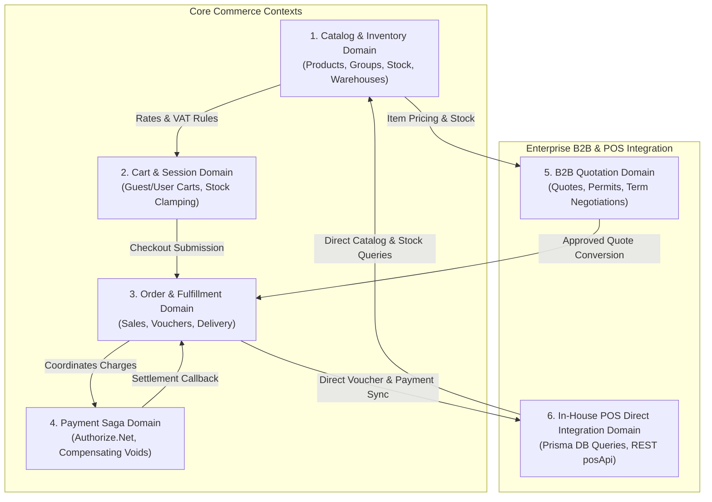

# Domain Map & System Decomposition

[← Main README](../README.md) · [← Documentation Index](README.md)

This document outlines the domain boundaries, bounded contexts, entity ownership, and interaction models of the **Enterprise Omnichannel E-Commerce Platform**.

---

## 1. Domain Decomposition Overview

The platform is decomposed into six cohesive bounded contexts:

---

## 2. Bounded Context Specifications

### 2.1 Catalog & Inventory Domain
- **Prisma Schema Models**: `products`, `productvariants`, `productgroup`, `brand`, `stock`, `warehouse`, `vat`, `unitconversions`.
- **Primary Responsibilities**:
  - Maintains product hierarchical taxonomy (`productgroup` parent/child nesting).
  - Manages variant-level pricing and SKU attributes (size, weight, packaging).
  - Tracks warehouse-specific stock quantities across multiple retail fulfillment nodes.
  - Houses tax categorization and percentage VAT rules (`vat` model).
- **Invariants & Rules**:
  - A product variant must belong to an active product.
  - VAT rates must be normalized to percentage evaluations ($\text{unitPrice} \times \text{qty} \times \frac{\text{vat}}{100}$).
  - Stock updates must not drop below zero unless backorders are explicitly permitted.

### 2.2 Cart & Session Domain
- **Prisma Schema Models**: `carts`, `cartitems`.
- **Primary Responsibilities**:
  - Manages anonymous shoppers via 30-day UUID HTTP-only cookies (`anonId`).
  - Provides atomic session merging when an anonymous shopper authenticates (`attachActiveCartToUser`).
  - Clamps requested quantities against live warehouse variant inventory during merge.
  - Emits normalized `CartSummary` and `CartLineDTO` objects to the client-side Zustand store (`cart-v2`).
- **Invariants & Rules**:
  - A customer may only have one `active` cart per `companyid` at any time.
  - An anonymous cart must transition to status `'merged'` upon successful attachment to a customer record.

### 2.3 Order & Fulfillment Domain
- **Prisma Schema Models**: `sales`, `saledetail`, `voucher`, `voucherdetail`, `customeraddress`.
- **Primary Responsibilities**:
  - Translates digital shopping carts into durable e-commerce sales records (`sales`).
  - Generates external ERP voucher orders in In-House POS (`/Voucher/order`).
  - Manages delivery vs. store pickup routing (`orderType`).
  - Tracks line item totals, discounts, shipping fees, and tax breakdowns.
- **Invariants & Rules**:
  - Grand total must strictly equal: $\text{Subtotal} + \text{Shipping} + \text{Total VAT} - \text{Discounts}$.
  - Every order must reference a verified billing and shipping customer address.

### 2.4 Payment Saga & Reconciliation Domain
- **Prisma Schema Models**: `voucherpayment`, `paymentoption`, Authorize.Net opaque nonces.
- **Primary Responsibilities**:
  - Dispatches browser card credentials to Authorize.Net Accept.js (PCI-DSS SAQ-A).
  - Orchestrates the two-phase payment saga (`AUTHONLYTRANSACTION` $\rightarrow$ POS Voucher $\rightarrow$ `PRIORAUTHCAPTURETRANSACTION` $\rightarrow$ POS Ledger).
  - Issues automated compensating voids on Authorize.Net if downstream POS steps fail.
  - Enforces strict anti-tampering validation ($|clientAmount - expectedAmount| \le 0.01$).
- **Invariants & Rules**:
  - No card may be captured prior to positive confirmation of store voucher creation.
  - Any failure in POS voucher creation or ledger settlement immediately triggers a compensating void.

### 2.5 B2B Quotation Domain
- **Prisma Schema Models**: `quote`, `quotedetail`, `customer`, `customerpermits`, `customertype`.
- **Primary Responsibilities**:
  - Enables commercial clients to request custom volume pricing and payment terms (`paymentterm`).
  - Supports dual-currency calculations (`totalinusd`, `totalinbs`, `exchangerate`).
  - Tracks validity windows with strict expiration dates (`expirydate`).
  - Converts approved quotations directly into confirmed sales orders without re-entering line items.
- **Invariants & Rules**:
  - Expired quotations cannot be converted into orders without commercial re-approval.
  - Quotes require commercial customer verification and permit validation (`customerpermits`).

### 2.6 In-House POS Direct Integration Domain
- **Infrastructure Components**: Direct PostgreSQL Connection via Prisma ORM 6.13, Prisma Accelerate Connection Pooler, Axios `posApi` Client.
- **Primary Responsibilities**:
  - Queries catalog taxonomy, variants, stock quantities, and historical sales rankings directly from the Core POS database.
  - Synchronizes orders with the In-House POS via `/Voucher/order`.
  - Settles store credit ledgers via `/Voucher/order/{id}/payment`.
  - Executes compensating order deletions via `DELETE /Voucher/order/{id}`.
  - Synchronizes customer authentication and address registries.

---

## 3. Context Map & Ubiquitous Language

| Context | Master Data Store | Consistency Model | Communication Protocol |
|---|---|---|---|
| **Catalog** | Core POS PostgreSQL (`products`) | Strong Consistency | Prisma ORM via Accelerate |
| **Cart** | Core POS PostgreSQL (`carts`) | Read-after-Write Consistency | Server Actions (`prisma.$transaction`) |
| **Orders** | In-House POS ERP + PostgreSQL | Dual-System Consensus | Distributed 2-Phase Saga |
| **Payments** | Authorize.Net | External Finality | REST API (Native SDK) |
| **B2B Quotes**| Core POS PostgreSQL (`quote`) | Eventual Consistency | Server Actions / Prisma ORM |
| **POS Sync** | Core POS PostgreSQL + POS API | Immediate Consensus | Direct Prisma Queries + REST `posApi` |

Related Guides: [System Architecture](architecture.md) · [Payment Saga Deep Dive](payment-saga-and-fault-tolerance.md) · [POS Direct Integration](pos-api-and-direct-database-integration.md)
