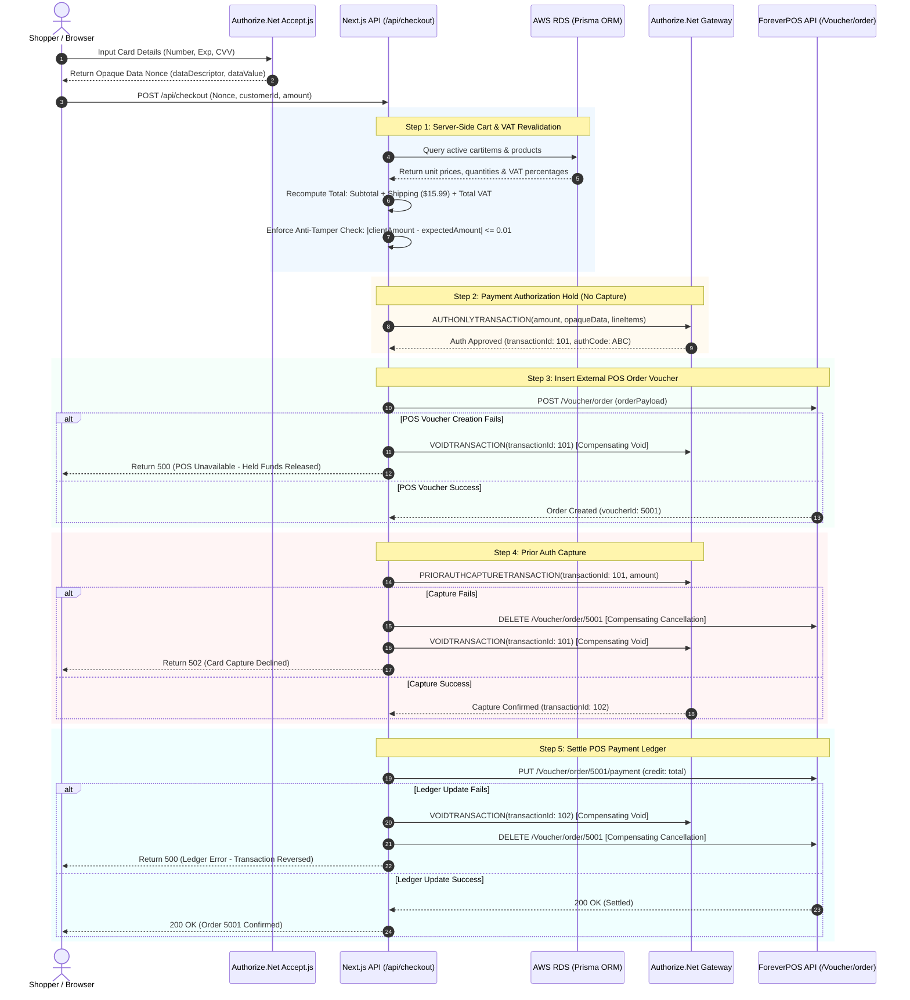

# Payment Saga & Distributed Fault Tolerance

[← Main README](../README.md) · [← Documentation Index](README.md)

This technical deep dive explores the distributed transaction architecture, fault tolerance mechanisms, and payment security boundaries engineered for the **Engel E-Commerce Platform**.

---

## 1. The Distributed Omnichannel Challenge

In a pure e-commerce platform, an order typically touches only the local database and a payment gateway. In an enterprise omnichannel retail architecture, however, every online purchase must reconcile across three independent distributed systems:

1. **Authorize.Net Payment Gateway**: Manages credit card tokenization, authorization holds, fund settlement, and chargeback prevention.
2. **AWS RDS PostgreSQL (Prisma ORM)**: Manages web customer accounts, active shopping carts, and digital checkout logs.
3. **ForeverPOS / SAK Retail Solutions**: The brick-and-mortar retail ERP responsible for store inventory decrements, physical warehouse picking slips, and fiscal accounting receipts.

Because these external systems communicate over public HTTP networks and do not support XA/2PC (Two-Phase Commit) distributed database protocols, traditional ACID transactions cannot span across them. 

### The Hazard of Single-Step Charges
If the application executed an immediate payment capture (`AUTH_CAPTURE`) and the subsequent call to the external POS API timed out or threw a 500 error, the customer's card would be billed for an order that the physical warehouse never received. This generates:
- **Ghost Charges**: Discrepancies between bank merchant deposits and store fiscal receipts.
- **Customer Frustration**: Shoppers charged for goods that never arrive.
- **Chargeback Penalties**: Merchant dispute fees and payment processor penalties.

---

## 2. Distributed Saga Flow

The platform resolves this using a **Two-Phase Commit Saga with Automated Compensating Transactions** orchestrated inside the Next.js checkout controller (`src/app/api/checkout/route.ts`).



---

## 3. Two-Phase Execution Stages

### 3.1 Pre-Flight Anti-Tamper & Tax Verification
Before contacting external payment networks, the controller performs an authoritative server-side recalculation:
```typescript
const cartRevalidationRes = await computeCart(paymentData.customerInfo.customerId);
const totalAmount = Number(cartRevalidationRes.total.toFixed(2));
const expectedAmount = totalAmount + SHIPPING_COST + cartRevalidationRes.totalVat;

// Tamper prevention
if (Math.abs(paymentData.amount - expectedAmount) > 0.01) {
  return NextResponse.json({ success: false, error: 'Payment amount does not match cart total' }, { status: 400 });
}
```
Value Added Tax (VAT) is calculated per line item based on the master rate defined in the database:
$$\text{Line VAT} = \text{unitPrice} \times \text{quantity} \times \left(\frac{\text{vatRate}}{100}\right)$$
$$\text{Total VAT} = \sum_{i=1}^{N} \text{Line VAT}_i$$

### 3.2 Phase 1: Authorization Hold (`AUTHONLYTRANSACTION`)
The server executes an authorization hold request via Authorize.Net:
- `transactionType`: `AUTHONLYTRANSACTION`
- `refTransId`: N/A (New transaction)
- **Result**: Cardholder bank validates available credit and locks the requested amount. No money is transferred or captured into merchant accounts.
- **Safe State**: If the system terminates here, the authorization hold naturally expires, or can be released instantaneously via a void.

### 3.3 Physical Store Order Reservation (`/Voucher/order`)
With funds guaranteed, the controller calls ForeverPOS (`POST /Voucher/order`) to:
- Generate a unique fiscal `voucherId`.
- Reserve physical stock in the assigned fulfillment warehouse (`wareHouseId: 1`).
- Create customer fulfillment delivery/pickup tracking metadata.

### 3.4 Phase 2: Prior Auth Capture (`PRIORAUTHCAPTURETRANSACTION`)
With the store order locked, the controller captures the held funds:
- `transactionType`: `PRIORAUTHCAPTURETRANSACTION`
- `refTransId`: The `transactionId` returned from Phase 1.
- **Result**: Authorize.Net transitions the hold into a captured transaction scheduled for batch settlement.

### 3.5 Ledger Reconciliation (`PUT /Voucher/order/{id}/payment`)
Finally, the controller settles the external POS accounting ledger:
- Credits the store's credit payment line (`credit: total`).
- Triggers physical receipt printing and customer email dispatch.

---

## 4. Compensating Transaction Matrix

| Step | Operation | Failure Trigger | Compensating Action | HTTP Response | Resulting State |
|---|---|---|---|---|---|
| **Step 1** | Authorization Hold | Card declined, invalid CVV, fraud filter | None required (no funds held) | `400 Bad Request` | Cart intact; user prompted to retry card. |
| **Step 2** | POS Voucher Creation | POS API 500/504, warehouse stock exhausted | `VOIDTRANSACTION(authTransId)` | `500 Internal Server Error` | Card hold released instantly; no voucher created. |
| **Step 3** | Prior Auth Capture | Gateway network error, account hold | `DELETE /Voucher/order/{id}`<br/>`VOIDTRANSACTION(authTransId)` | `502 Bad Gateway` | POS voucher cancelled; card hold voided. |
| **Step 4** | POS Ledger Settlement | POS ledger DB lock, accounting timeout | `VOIDTRANSACTION(captureTransId)`<br/>`DELETE /Voucher/order/{id}` | `500 Internal Server Error` | Captured payment reversed; POS voucher deleted. |

---

## 5. Security & PCI-DSS SAQ-A Boundary

The Engel E-Commerce architecture satisfies **PCI-DSS SAQ-A** compliance:

1. **Client-Side Tokenization**: Cardholder data (PAN, CVV, expiration date) is entered into form fields managed by Authorize.Net's `Accept.js` library.
2. **Zero Plaintext Card Storage**: Card data is transmitted over TLS directly from the shopper's browser to Authorize.Net. The browser receives an ephemeral `opaqueData` token (`dataDescriptor: "COMMON.ACCEPT.INAPP.PAYMENT"`, `dataValue: "ey..."`).
3. **Application Server Isolation**: The Next.js backend only ever receives and transmits the opaque nonce and amount. Plaintext credit card numbers never touch application memory, logs, or databases.
4. **Environment Switching**: In `src/app/layout.tsx`, the platform dynamically loads either the sandbox or production Accept.js bundle based on `NEXT_PUBLIC_AUTHORIZE_NET_ENV`:
   ```typescript
   const authorizeEnv = process.env.NEXT_PUBLIC_AUTHORIZE_NET_ENV ?? 'sandbox';
   const acceptJsSrc = authorizeEnv === 'production' || authorizeEnv === 'prod'
     ? 'https://js.authorize.net/v1/Accept.js'
     : 'https://jstest.authorize.net/v1/Accept.js';
   ```

Related Guides: [System Architecture](architecture.md) · [Code Examples](code-examples.md) · [ADR 003](decisions/003-two-phase-payment-saga.md)
