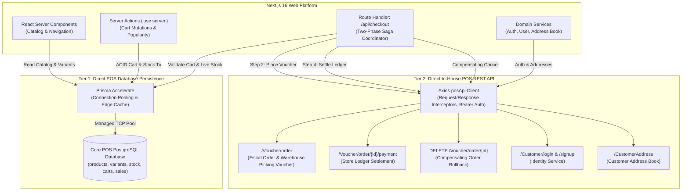

# In-House POS Direct API & Database Integration Architecture

[← Main README](../README.md) · [← Documentation Index](README.md)

This document details the direct dual-tier integration architecture bridging the digital web storefront with the brick-and-mortar Point-of-Sale (POS) ERP system, bypassing asynchronous intermediate compute in favor of **direct POS database access** and **authoritative in-house POS REST APIs**.

---

## 1. Dual-Tier Integration Paradigm

In high-concurrency retail environments, catalog synchronization pipelines built on asynchronous batch workers or intermediate queues suffer from data staleness, inventory overselling, and delayed order status propagation. 

The platform eliminates intermediate batch layers by employing a **Dual-Tier Direct POS Integration**:



---

## 2. Tier 1: Direct POS Database Persistence (Prisma ORM 6.13)

The Next.js storefront communicates directly with the Core POS PostgreSQL database via **Prisma ORM 6.13**, augmented by **`@prisma/extension-accelerate`** for serverless connection pooling and edge-level caching.

### 2.1 Catalog & Live Stock Queries
Catalog exploration queries read directly from relational POS tables, ensuring that pricing adjustments, stock decrements, and product taxonomy changes made in physical stores are reflected immediately online:

```typescript
// src/server/queries/product.ts
export const getPopularProducts = async ({ page = 1, pageSize = 10, categoryId = 0 }) => {
  const products = await prisma.products.findMany({
    where: {
      companyid: +COMPANY_ID,
      ...(categoryId !== 0 && { productgroupid: categoryId }),
    },
    select: {
      productid: true,
      productname: true,
      description: true,
      rate: true,
      images: true,
      productgroup: { select: { groupid: true, groupname: true } },
      productvariants: { select: { variantid: true, sku: true, price: true } },
    },
  });
  // ...
};
```

### 2.2 Live Stock Clamping & ACID Cart Mutations
When customers add or modify items in their shopping carts, Server Actions query live inventory levels (`variant.stockquantity`) within interactive Prisma transactions (`prisma.$transaction`). If a store cashier sells the last physical unit, the online cart automatically clamps requested quantities to available stock:

```typescript
// src/server/queries/cart-action.ts
const result = await prisma.$transaction(async (tx) => {
  const variant = await tx.productvariants.findUnique({
    where: { variantid: variantId },
    select: { variantid: true, sku: true, price: true, stockquantity: true },
  });

  const serverStock = variant?.stockquantity != null ? Number(variant.stockquantity) : null;
  const available = Number.isFinite(serverStock) ? Number(serverStock) : Number.POSITIVE_INFINITY;
  // Enforce server-authoritative stock clamp
});
```

### 2.3 Connection Pooling & Resilience
Direct database queries from serverless runtimes risk exhausting PostgreSQL `max_connections`. The platform multiplexes database traffic via Prisma Accelerate, maintaining a persistent pool of pre-warmed TCP sockets:
- **Global Edge Caching**: Non-volatile catalog taxonomy (`productgroup`, `brand`) uses `cacheStrategy: { ttl: 300, swr: 60 }`.
- **Transactional Pass-Through**: All interactive cart and checkout writes bypass caches to enforce immediate read-after-write consistency.

---

## 3. Tier 2: Direct In-House POS REST API Client (`posApi`)

While read queries and session carts operate directly against the database, transactional order creation, store ledger settlement, customer authentication, and fiscal accounting require POS business logic execution. These are performed via direct HTTP calls to the in-house POS REST API.

### 3.1 Client Configuration & Interceptors
The application instantiates a specialized Axios client configured for POS communication:

```typescript
// src/lib/axiosInstance.ts
export const posApi = axios.create({
  baseURL: process.env.NEXT_PUBLIC_POS_API_URL,
  headers: {
    'Content-Type': 'application/json',
  },
  timeout: 10000, // 10-second request timeout
});

// Automatic Bearer Token Injection
posApi.interceptors.request.use(async (config) => {
  if (typeof window === 'undefined') return config;
  const token = localStorage.getItem('accessToken');
  if (token) {
    config.headers = config.headers || {};
    config.headers.Authorization = `Bearer ${token}`;
  }
  return config;
});
```

### 3.2 Key POS REST API Endpoints

| Endpoint | Method | Operational Scope | Payload / Parameters |
|---|---|---|---|
| `/Voucher/order` | `POST` | Creates physical store voucher, locks inventory, generates fiscal `voucherId`. | `Order` object (customer, delivery, items, totals). |
| `/Voucher/order/{id}/payment` | `PUT` | Settles payment amount against POS accounting ledger. | `{ cash: 0, credit: total, sendEmail: true }`. |
| `/Voucher/order/{id}` | `DELETE` | Cancels voucher if payment capture or ledger update fails. | Order voucher ID + Auth token. |
| `/Customer/login` | `POST` | Authenticates customer against POS user registry. | `{ email, password, companyId }`. |
| `/Customer/signup` | `POST` | Registers new customer directly in POS database. | `{ name, email, password, companyId }`. |
| `/CustomerAddress` | `GET/POST/PUT/DELETE` | Manages customer billing and shipping address book. | `CustomerAddress` entity. |

### 3.3 Transactional Checkout Integration (`src/app/api/checkout/lib/pos.ts`)
The checkout saga interacts with the POS API at three critical phases:

```typescript
// 1. Order Voucher Creation
export const insertOrderThroughApi = async (order: Order, authHeader: string) => {
  const res = await posApi.post('/Voucher/order', order, {
    headers: { Authorization: authHeader },
  });
  return res.data;
};

// 2. Payment Status Settlement
export const updatePaymentStatus = async (id: string, total: number, authHeader: string) => {
  const updatePaymentPayload = {
    cash: 0,
    credit: total,
    zilla: 0,
    otherPayment: 0,
    shippingAmount: 0,
    sendEmail: true,
  };
  const res = await posApi.put(`/Voucher/order/${id}/payment`, updatePaymentPayload, {
    headers: { Authorization: authHeader },
  });
  return { success: [200, 201, 202, 204].includes(res.status) };
};

// 3. Compensating Cancellation
export const cancelPosOrder = async (id: string, authHeader: string) => {
  try {
    await posApi.delete(`/Voucher/order/${id}`, { headers: { Authorization: authHeader } });
    return { success: true };
  } catch (error) {
    console.error('Failed to cancel POS order', error);
    return { success: false };
  }
};
```

---

## 4. Advantages Over Intermediate Asynchronous Architectures

1. **Zero Eventual Consistency Drift**: Shoppers and store cashiers share the identical inventory state in real-time, eliminating double-selling of low-stock items.
2. **Simplified Cloud Topology**: Eliminates the operational overhead of message queues, event buses, and asynchronous worker runtimes.
3. **Synchronous Checkout Guarantees**: Customers receive instantaneous order confirmation with their fiscal POS voucher ID upon card settlement.
4. **Deterministic Failure Compensation**: Network or gateway errors trigger immediate synchronous compensations (e.g. canceling the voucher or voiding held card funds) before responding to the user.

Related Guides: [System Architecture](architecture.md) · [Payment Saga Deep Dive](payment-saga-and-fault-tolerance.md) · [Prisma Database](prisma-database-architecture.md)
