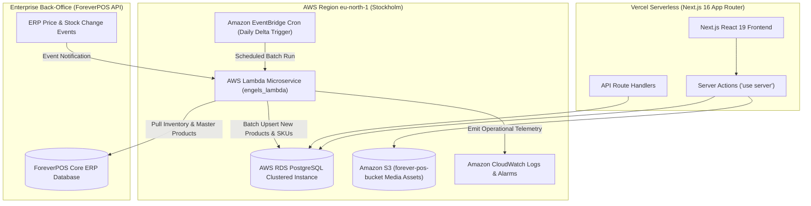

# Serverless Infrastructure & AWS Lambda Event Pipeline

[← Main README](../README.md) · [← Documentation Index](README.md)

This document details the serverless operational architecture and event synchronization microservices powering **Engel E-Commerce**, focusing on `engels_lambda` in AWS Cloud (`eu-north-1` Stockholm).

---

## 1. Cloud Architecture & Infrastructure Topology



---

## 2. The `engels_lambda` Microservice

Located at `/home/mnk/Code/serverless/aws_lambdas/engels_lambda`, this containerized Python microservice bridges physical warehouse changes from the back-office ERP into the consumer Next.js application:

### Key Responsibilities
1. **Delta Inventory Synchronization**: Periodically polls the ERP for modified stock quantities across multiple fulfillment warehouses and writes atomic updates to the `stock` table in AWS RDS.
2. **Catalog Import & Enrichment**: Transforms raw vendor catalog CSV/JSON payloads into structured hierarchical product groups, assigning default VAT rates (Danish MOMS 25% or zero-rated export).
3. **Image Normalization & S3 Sync**: Downloads supplier asset photos, optimizes dimensions and WebP encoding, and uploads them to Amazon S3 (`forever-pos-bucket`) with immutable CDN caching headers.

### Lambda Handler Implementation Skeleton
```python
import os
import json
import psycopg2
import boto3

def lambda_handler(event, context):
    """
    AWS Lambda entrypoint triggered via EventBridge or API Gateway.
    Executes idempotent batch catalog synchronization.
    """
    db_conn = psycopg2.connect(os.environ['DATABASE_URL'])
    cursor = db_conn.cursor()
    
    try:
        cursor.execute("SELECT pg_advisory_xact_lock(987654321);") # Prevent concurrent runs
        sync_delta_catalog(cursor)
        db_conn.commit()
        return {
            'statusCode': 200,
            'body': json.dumps({'status': 'success', 'synced': True})
        }
    except Exception as e:
        db_conn.rollback()
        print(f"Sync failed: {str(e)}")
        raise e
    finally:
        cursor.close()
        db_conn.close()
```

---

## 3. Operational Resilience & Fault Recovery

- **Advisory Locks**: The ETL pipeline acquires a transactional PostgreSQL advisory lock (`pg_advisory_xact_lock`) at the start of execution. If a previous run is delayed, subsequent cron triggers immediately exit rather than corrupting catalog tables with duplicate concurrent batch writes.
- **Dead Letter Queue (DLQ)**: Failed sync events are routed to an Amazon SQS DLQ for manual inspection and automated retry.

Related: [Architecture](architecture.md) · [Prisma Database](prisma-database-architecture.md) · [Payment Saga](payment-saga-and-fault-tolerance.md)
